<div align="center">

# 🚚 LogiAI

### Predict delivery delay risk and serve it through a REST API


</div>

---

## 📖 Table of Contents

- [About the Project](#-about-the-project)
- [Architecture](#-architecture)
- [Features](#-features)
- [Tech Stack](#-tech-stack)
- [Project Structure](#-project-structure)
- [Getting Started](#-getting-started)
- [Usage](#-usage)
- [API Reference](#-api-reference)
- [Streamlit Client](#-streamlit-client)
- [Testing](#-testing)
- [Design Decisions](#-design-decisions)
- [Extensions & Roadmap](#-extensions--roadmap)
- [Git Workflow](#-git-workflow)
- [Authors](#-authors)
- [Acknowledgements](#-acknowledgements)

---

## 🎯 About the Project

A transport company wants to warn its dispatchers when a delivery is likely to arrive **late**. A machine learning model already exists, but it is locked inside a Python script: only the person who owns the script can use it.

**LogiAI turns that model into a service.** A dashboard, a mobile app or a Streamlit interface sends the characteristics of a delivery over the network and receives back the **probability of delay**, along with an **alert** if it exceeds the threshold (**0.4**).

```
Before :  [ script + model ]                  → a single user

After  :  [ Streamlit ] --\
          [ Mobile    ] ----HTTP/JSON--> [ FastAPI API + model ]
          [ Dashboard ] --/
```

> This project was built as part of **Atelier 3 – REST API with FastAPI** for the module *Développement et déploiement d'applications intelligentes* at **EMSI** (École Marocaine des Sciences de l'Ingénieur), academic year 2026–2027.

---

## 🏗 Architecture

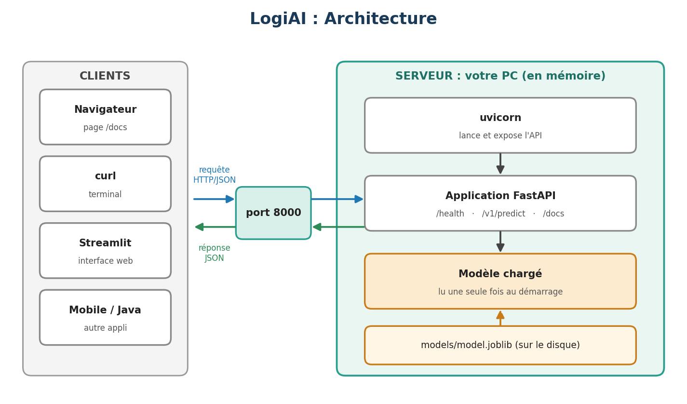

| Layer | Role |
|-------|------|
| **uvicorn** | Launches the app and listens on port `8000` |
| **FastAPI application** | Defines the routes: `/health`, `/v1/predict`, `/docs` |
| **Model (`model.joblib`)** | Loaded **once at startup** and kept in memory for fast responses |
| **Clients** | Browser (`/docs`), `curl`, Streamlit, mobile apps, Java… |

---

## ✨ Features

- 🔮 **Delay prediction** – returns the probability of delay for a delivery and an alert flag
- ✅ **Strict input validation** with Pydantic: types, physical bounds and documented fields
- 📚 **Auto-generated documentation** (Swagger UI) at `/docs`
- ⚡ **Model loaded once** at startup through FastAPI's `lifespan`
- 🚦 **Meaningful HTTP status codes**: `200`, `422` (invalid input), `503` (model not loaded)
- ❤️ **Health endpoint** reporting whether the model is loaded
- 🧪 **Automated test suite** with `pytest` (`TestClient`), 15 tests
- 🖥 **Streamlit client** that contains *no model*, only HTTP calls to the API

---

## 🛠 Tech Stack

| Category | Technology |
|----------|-----------|
| Language | Python |
| API framework | FastAPI |
| ASGI server | uvicorn |
| Validation | Pydantic |
| Machine learning | scikit-learn, joblib |
| Client UI | Streamlit, requests |
| Testing | pytest |
| Version control | Git / GitHub |

---

## 📂 Project Structure

```
LogiAI/
├── logiai/
│   ├── config.py          # settings: paths, alert threshold (0.4), variable names
│   ├── dataset.py         # generates the deliveries dataset
│   ├── train.py           # trains the model and saves it
│   ├── predict.py         # loads the model and predicts for one delivery
│   └── api/
│       ├── schemas.py     # Pydantic schemas (input "Livraison" / output "PredictionOut")
│       └── main.py        # FastAPI app and routes
├── tests/
│   └── test_api.py        # API test suite
├── docs/
│   └── screenshots/       # images used in this README
├── data/
│   └── livraisons.csv     # generated dataset (not tracked by Git)
├── models/
│   └── model.joblib       # trained model (not tracked by Git)
├── streamlit_app.py       # Streamlit client
├── requirements.txt
├── COMPTE_RENDU.md        # lab report
└── README.md
```

> ⚠️ `.venv/`, `data/*.csv`, `models/` and `.env` are **never committed** (see `.gitignore`).

---

## 🚀 Getting Started

### Prerequisites

- Python 3.10+
- Git

### Installation

```bash
# 1. Clone the repository
git clone https://github.com/anaskoukham49/LogiAI.git
cd LogiAI

# 2. Switch to the working branch
git switch tp-api

# 3. Create and activate a virtual environment
python -m venv .venv

# Windows (cmd)
.venv\Scripts\activate.bat
# Windows (PowerShell)
.venv\Scripts\Activate.ps1
# macOS / Linux
source .venv/bin/activate

# 4. Install dependencies
pip install -r requirements.txt

# 5. Generate the data and train the model
python -m logiai.dataset      # writes data/livraisons.csv
python -m logiai.train        # writes models/model.joblib
```

Training reports a baseline accuracy of **0.726** (always answering "on time"), a model accuracy of **0.774** and a recall of **0.464**: the model detects about 46 real delays out of 100, which the baseline never does.

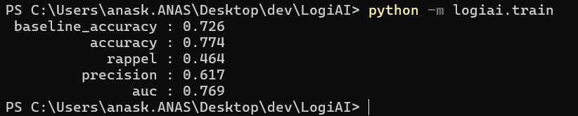

---

## ▶️ Usage

### Start the API

```bash
python -m uvicorn logiai.api.main:app --reload
```

The API is now available at **http://localhost:8000** and the interactive documentation at **http://localhost:8000/docs**.

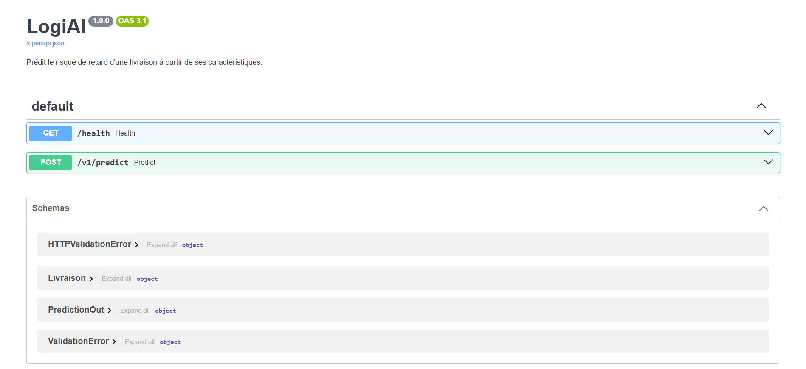

### Quick test with `curl`

```bash
curl http://localhost:8000/health
```

```bash
curl -X POST http://localhost:8000/v1/predict \
  -H "Content-Type: application/json" \
  -d @livraison.json
```

> 💡 On Windows (cmd / PowerShell) use `curl.exe` and **do not** wrap the JSON in single quotes: pass it from a file with `-d @livraison.json`.

---

## 📡 API Reference

### `GET /health`

Checks that the service is running and whether the model is loaded.

```json
{ "status": "ok", "model_loaded": true }
```

### `POST /v1/predict`

Predicts the risk of delay for a single delivery.

**Request body (the API "contract")**

| Field | Type | Allowed range | Description |
|-------|------|---------------|-------------|
| `distance_km` | float | 1 to 1000 | Trip distance in km |
| `poids_kg` | float | 0.1 to 30000 | Transported weight in kg |
| `heure_depart` | int | 0 to 23 | Departure hour |
| `pluie_mm` | float | 0 to 200 | Forecast rainfall along the route (mm) |
| `trafic_index` | float | 0 to 10 | Traffic index: 0 = free-flowing, 10 = saturated |
| `nb_arrets` | int | 0 to 50 | Number of delivery stops |
| `type_vehicule` | string | `"moto"`, `"fourgon"`, `"camion"` | Vehicle type |

**Example request**

```json
{
  "distance_km": 120,
  "poids_kg": 450,
  "heure_depart": 17,
  "pluie_mm": 8.0,
  "trafic_index": 7.5,
  "nb_arrets": 4,
  "type_vehicule": "camion"
}
```

**Response body**

| Field | Type | Description |
|-------|------|-------------|
| `probabilite_retard` | float | Probability that the delivery is late (0 to 1) |
| `alerte` | bool | `true` when the probability reaches the threshold |
| `seuil` | float | Alert threshold used (0.4, defined in `config.py`) |
| `model_version` | string | Version of the model that produced the prediction |

**Example response** (`200 OK`)

```json
{
  "probabilite_retard": 0.73,
  "alerte": true,
  "seuil": 0.4,
  "model_version": "1.0"
}
```

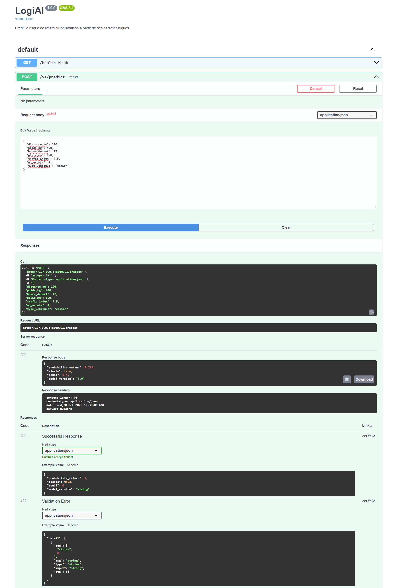

### Status codes

| Code | Meaning | When it happens in LogiAI |
|------|---------|---------------------------|
| `200` | Success | Prediction returned |
| `404` | Unknown route | Typo in the URL (e.g. `/v1/predcit`) |
| `422` | Invalid input | Out-of-range or malformed value (e.g. 500 mm of rain, `distance_km = -5`, `type_vehicule = "avion"`) |
| `500` | Server error | Bug in the code |
| `503` | Service unavailable | Model not loaded |

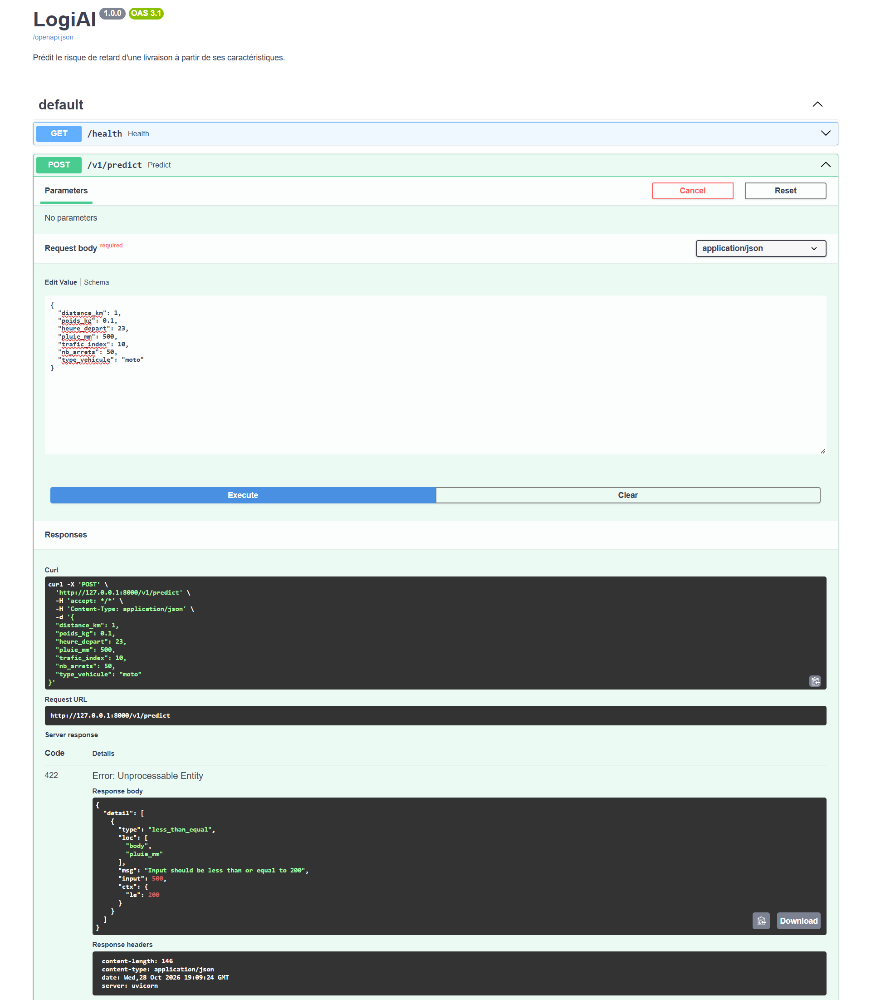

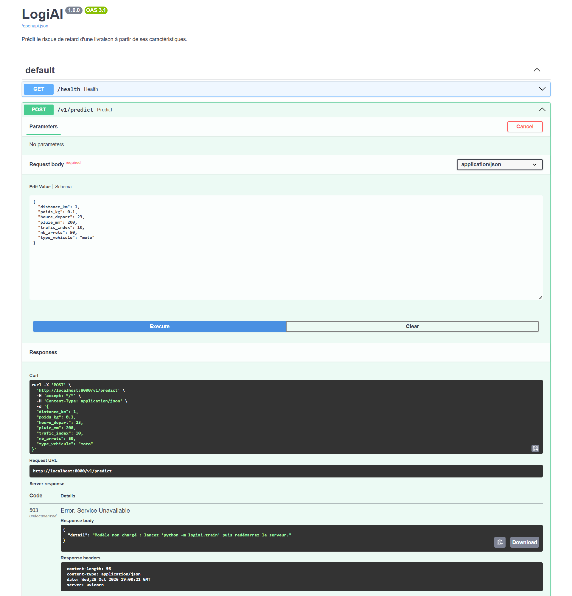

---

## 🖥 Streamlit Client

A web interface that calls the API through `POST /v1/predict`. It does **not** import scikit-learn or the model: the API is the single source of truth.

Open **two terminals**:

```bash
# Terminal 1: the API
python -m uvicorn logiai.api.main:app --reload

# Terminal 2: the interface
streamlit run streamlit_app.py
```

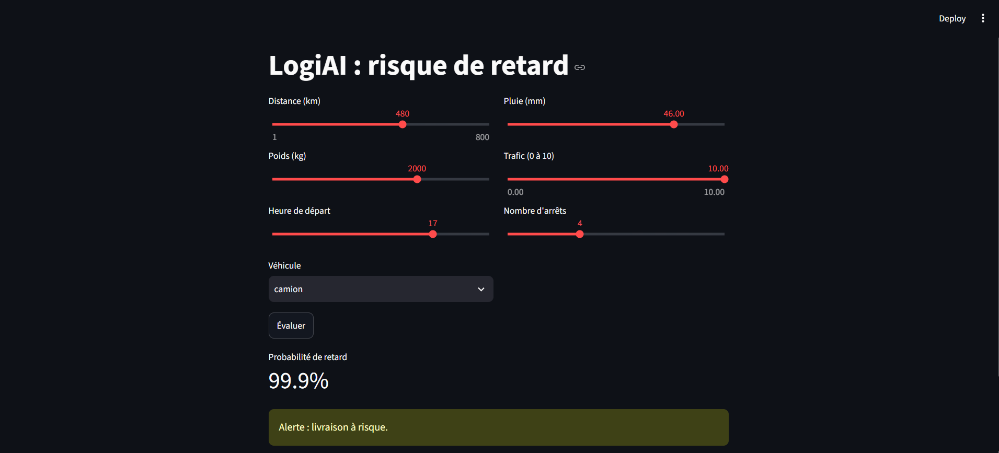

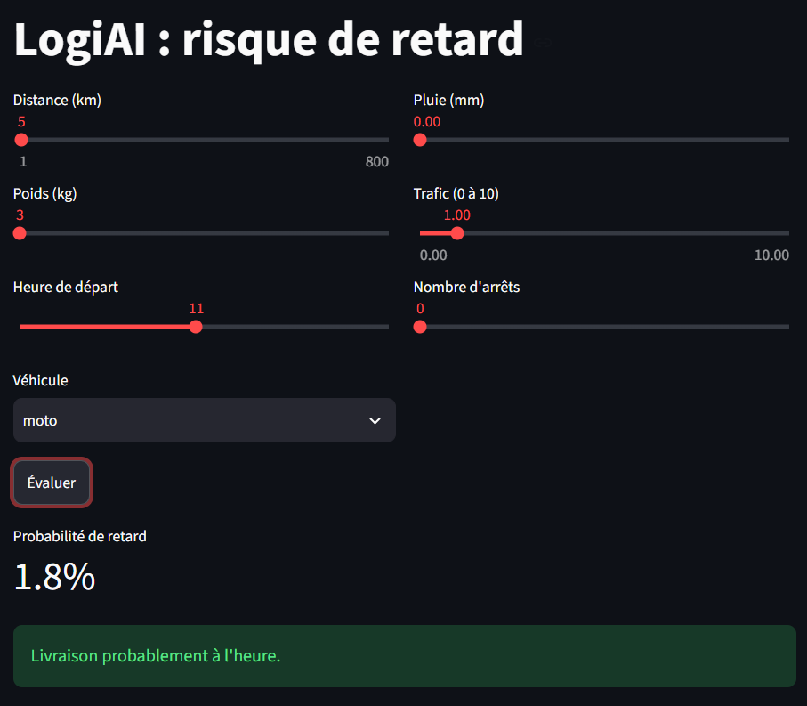

If the API is not running, the interface shows a clear error instead of crashing:

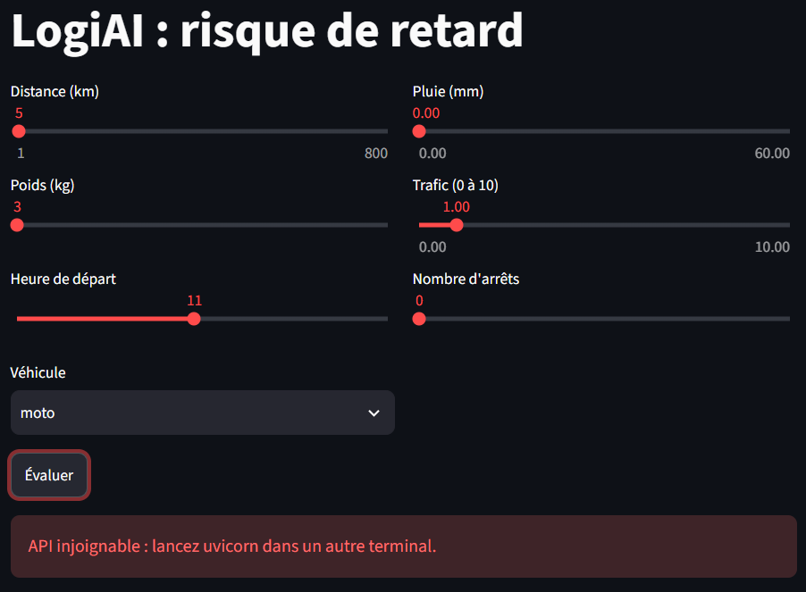

---

## 🧪 Testing

```bash
python -m pytest
```

The test suite uses `TestClient(app)` inside a `with` block, so the application's startup (and therefore the model loading) runs exactly as on a real server. It contains 15 tests covering the health route, the response shape, the validation bounds (`422`), the missing-model case (`503`), and two additional tests: an out-of-range departure hour (`24`) is rejected, and the `alerte` flag is always consistent with the threshold.

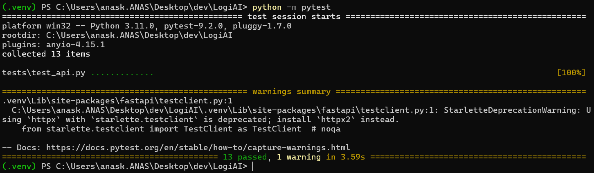

---

## 🧠 Design Decisions

**Why a schema?** One Pydantic class is written once and used for three things: it **validates** requests (automatic `422`), **documents** the API (`/docs`), and provides a **typed Python object** inside the route.

**Why load the model at startup?** Loading from disk on every request would be slow and wasteful. The model is read once in `lifespan` and reused from memory.

**Why `503` and not `500` when the model is missing?** A missing model is not a bug in the code but a temporary unavailability of the service, so `503 Service Unavailable` with a message explaining what to do is the correct signal for clients.

**Why start the API even without the model?** The server still starts and `/health` reports `model_loaded: false`, so a supervisor can tell "model missing" apart from "server crashed". Prediction requests get a clear `503`.

**Physical bounds, not data bounds.** Field limits reflect what a real trip can look like, not the min/max of `livraisons.csv`, otherwise a slightly longer real delivery would be wrongly rejected.

---

## 🔭 Extensions & Roadmap

- [ ] **Batch prediction**: `POST /v1/predict-batch` accepting a list of deliveries
- [ ] **Model info route**: `GET /v1/model-info` (version, features, metrics)
- [ ] **API key protection** via an `X-API-Key` header (`401` if missing/invalid)
- [ ] **Image prediction** route (`UploadFile`) for the MNIST model
- [ ] **Threshold tuning**: study the precision/recall trade-off of `ALERT_THRESHOLD`
- [ ] Containerization and deployment

---

## 🌿 Git Workflow

The project is developed on the **`tp-api`** branch and submitted through a **pull request**.

```bash
git switch -c tp-api
git add .
git commit -m "TP API: schema, predict, tests, Streamlit client"
git pull        # always pull before pushing
git push -u origin tp-api
```

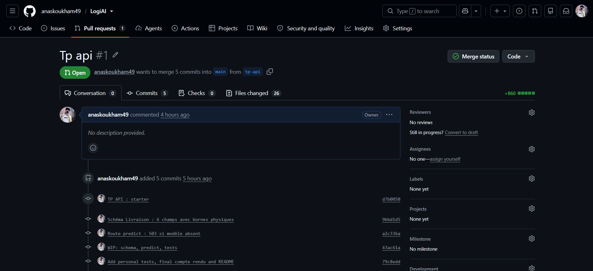

---

## 👥 Authors

| Name | GitHub |
|------|--------|
| **Anas Koukham** | [@anaskoukham49](https://github.com/anaskoukham49) |

---

## 🙏 Acknowledgements

- **Pr. Soukaina Gouraguine** – module supervisor
- **EMSI – École Marocaine des Sciences de l'Ingénieur**
- [FastAPI](https://fastapi.tiangolo.com/), [Pydantic](https://docs.pydantic.dev/), [Streamlit](https://streamlit.io/), [scikit-learn](https://scikit-learn.org/)

---

<div align="center">

Made with ❤️ at EMSI · 2026–2027

</div>
